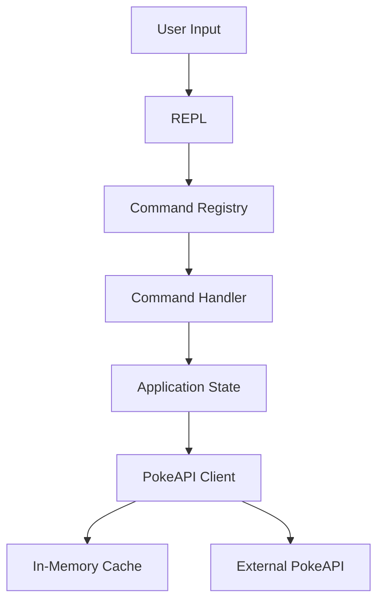

# Pokedex CLI


An interactive command-line Pokedex application built with TypeScript and Node.js as part of the [Boot.dev Build a Pokedex](https://www.boot.dev/courses/build-pokedex-cli-typescript) guided project.

The application allows users to explore Pokemon locations, catch Pokemon, inspect their statistics, and manage a personal Pokedex through an interactive REPL.

## Demo


## Features

- Interactive command-line REPL
- Explore Pokemon location areas
- Forward and backward API pagination
- Pokemon catching based on base experience
- Personal in-memory Pokedex
- Inspect Pokemon statistics and types
- In-memory API response caching
- Automatic cache expiration and cleanup
- Error handling for invalid commands and API requests
- Unit testing with Vitest

## Tech Stack

| Technology | Purpose |
| --- | --- |
| TypeScript | Application language and type safety |
| Node.js | JavaScript runtime |
| PokeAPI | External REST API |
| Readline | Interactive command-line input |
| Vitest | Unit testing |
| NVM | Node.js version management |

## Architecture

The application uses a modular, command-based architecture that separates user input, command execution, application state, API requests, and caching.



### Main Components

- **REPL:** Reads user input and dispatches commands.
- **Command Registry:** Maps available commands to their callback functions.
- **Command Handlers:** Implement individual application features.
- **Application State:** Manages pagination, caught Pokemon, and shared resources.
- **PokeAPI Client:** Handles asynchronous HTTP requests.
- **Cache:** Stores API responses temporarily and removes expired entries.

## Available Commands

| Command | Description |
| --- | --- |
| `help` | Display available commands |
| `map` | Display the next 20 location areas |
| `mapb` | Display the previous 20 location areas |
| `explore <location>` | Explore Pokemon within a location |
| `catch <pokemon>` | Attempt to catch a Pokemon |
| `inspect <pokemon>` | Display information about a caught Pokemon |
| `pokedex` | List all caught Pokemon |
| `exit` | Exit the application |

## Example Usage

Explore a location:

```text
Pokedex > explore pastoria-city-area

Exploring pastoria-city-area...
Found Pokemon:
 - tentacool
 - tentacruel
 - magikarp
 - gyarados
```

Catch a Pokemon:

```text
Pokedex > catch pikachu

Throwing a Pokeball at pikachu...
pikachu was caught!
```

Inspect a caught Pokemon:

```text
Pokedex > inspect pikachu

Name: pikachu
Height: 4
Weight: 60
Stats:
 - hp: 35
 - attack: 55
 - defense: 40
Types:
 - electric
```

## Caching

The application implements an in-memory cache for API responses.

- Reduces unnecessary network requests
- Improves response times for repeated commands
- Supports configurable cache expiration
- Automatically removes expired entries
- Uses TypeScript generics for type-safe cached data

## Project Structure

```text
Pokedex/
├── assets/
│   └── demo.png
├── src/
│   ├── command_catch.ts
│   ├── command_exit.ts
│   ├── command_explore.ts
│   ├── command_help.ts
│   ├── command_inspect.ts
│   ├── command_map.ts
│   ├── command_mapb.ts
│   ├── command_pokedex.ts
│   ├── commands.ts
│   ├── main.ts
│   ├── pokeapi.ts
│   ├── pokecache.ts
│   ├── repl.ts
│   ├── repl.test.ts
│   └── state.ts
├── .nvmrc
├── package.json
├── tsconfig.json
└── README.md
```

## Getting Started

### Requirements

- Node.js
- npm
- Git
- NVM (recommended)

### Installation

```bash
git clone https://github.com/MhmdRayanm7/Pokedex.git
cd Pokedex

nvm install
nvm use

npm ci
```

### Run the Application

```bash
npm run build
npm start
```

Alternatively, run in development mode:

```bash
npm run dev
```

## Testing

Run the test suite:

```bash
npm test
```

The project uses Vitest to test input parsing and cache behavior.

## npm Scripts

| Command | Description |
| --- | --- |
| `npm run dev` | Compile and run the application |
| `npm run build` | Compile TypeScript |
| `npm start` | Run the compiled application |
| `npm test` | Run the Vitest test suite |

## Concepts Practiced

- REST API integration
- Asynchronous programming and promises
- HTTP requests and JSON responses
- API pagination
- In-memory caching and cache expiration
- TypeScript interfaces and generics
- Application state management
- Command registry design
- Modular application architecture
- Error handling
- Unit testing

## External API

Pokemon and location data are provided by [PokeAPI](https://pokeapi.co/).

An internet connection is required to retrieve data that is not already cached.

---

Built as part of the [Boot.dev](https://www.boot.dev/) backend development learning path.
