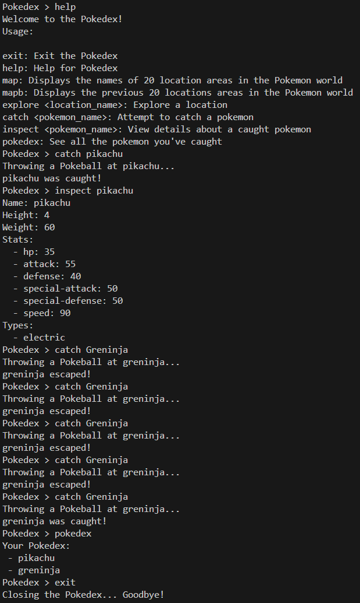

# Pokedex CLI


A command-line Pokedex application built with TypeScript and Node.js.

The application runs as an interactive REPL and allows users to explore Pokemon locations, catch Pokemon, inspect caught Pokemon, and view their personal Pokedex.

## Demo



## Features

- Interactive command-line REPL
- Explore Pokemon location areas
- Paginate forward and backward through locations
- Catch Pokemon with a probability based on base experience
- Store caught Pokemon in a personal Pokedex
- Inspect Pokemon stats and types
- Cache API responses for faster repeated requests
- Automatic cache cleanup
- Error handling for invalid commands and API requests
- Unit tests with Vitest


## Architecture

The project uses a simple command-based architecture:

```text
User Input
   ↓
REPL
   ↓
Command Registry
   ↓
Command Handler
   ↓
State
   ↓
PokeAPI Client
   ↓
Cache
   ↓
PokeAPI
```

### Main Components

- **REPL**  
  Reads user input and passes commands to the correct handler.

- **Command Registry**  
  Stores all available commands and their callback functions.

- **Command Handlers**  
  Each command has its own file and handles one responsibility.

- **State**  
  Stores shared application data such as the PokeAPI client, pagination URLs, and caught Pokemon.

- **PokeAPI Client**  
  Handles requests to the external Pokemon API.

- **Cache**  
  Stores recent API responses to avoid unnecessary repeated requests.


## Commands

### help

Displays all available commands.

### map

Displays the next 20 Pokemon location areas.

### mapb

Displays the previous 20 location areas.

### explore <location_name>

Displays Pokemon that can be found in a location.

Example:

```text
explore pastoria-city-area
```

### catch <pokemon_name>

Attempts to catch a Pokemon.

Example:

```text
catch pikachu
```

### inspect <pokemon_name>

Displays information about a Pokemon that has already been caught.

Example:

```text
inspect pikachu
```

### pokedex

Displays all Pokemon currently stored in your Pokedex.

### exit

Closes the application.

## Example

```text
Pokedex > explore pastoria-city-area
Exploring pastoria-city-area...
Found Pokemon:
 - tentacool
 - tentacruel
 - magikarp
 - gyarados

Pokedex > catch pikachu
Throwing a Pokeball at pikachu...
pikachu was caught!

Pokedex > inspect pikachu
Name: pikachu
Height: 4
Weight: 60
Stats:
 - hp: 35
 - attack: 55
 - defense: 40
Types:
 - electric
```

## Technologies

- TypeScript
- Node.js
- PokeAPI
- Vitest

## Project Structure

```text
src/
├── command_catch.ts
├── command_exit.ts
├── command_explore.ts
├── command_help.ts
├── command_inspect.ts
├── command_map.ts
├── command_mapb.ts
├── command_pokedex.ts
├── commands.ts
├── main.ts
├── pokeapi.ts
├── pokecache.ts
├── repl.ts
├── repl.test.ts
└── state.ts
```

## Installation

Clone the repository:

```bash
git clone https://github.com/MhmdRayanm7/Pokedex.git
cd Pokedex
```

Install dependencies:

```bash
npm install
```

## Running the Project

Build the project:

```bash
npm run build
```

Run the application using the script configured in `package.json`.

## Tests

Run the test suite with:

```bash
npm test
```

The project uses Vitest for testing input parsing and cache behavior.

## API

Pokemon and location data are provided by the PokeAPI.

API responses are cached temporarily to reduce unnecessary repeated network requests and improve response time.

## What I Practiced

This project helped me practice:

- Building a command-line REPL
- Working with asynchronous TypeScript
- Consuming REST APIs
- Managing application state
- Designing a command registry
- Working with generic types
- Implementing caching
- Handling pagination
- Error handling
- Writing unit tests
